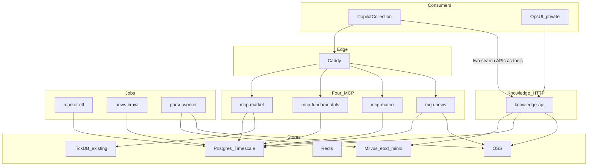

# 金融数据中台目标部署形态

一台 Linux + Compose。结构化数据四套 MCP（行情、基本面、宏观、资讯公告）。RAG 做成两条 HTTP API（研报检索、政策检索），由 Copilot 等下游自己封装成工具调用。向量集合为 `finance_report` 与 `finance_policy`。

## 待办

- Linux 上收口一份 Compose：postgres/redis/milvus 全家桶，统一 restart 与健康检查
- 投研迁入 `finance_report`；删除 `finance_kb` 的合规/运营/管理类别及文档；废弃 `finance_kb` 与四类逻辑库
- 两条检索 API：`POST` 研报检索（`finance_report`）、`POST` 政策检索（`finance_policy`）；供下游封装为工具
- mcp-market：`resolve_symbol`、`get_ohlcv`；实时报价先适配现有 TickDB
- mcp-fundamentals：财务报表、估值与比率、多公司对比
- mcp-macro：宏观指标与经济日历
- mcp-news：新闻检索、公告/申报、业绩日历
- schema（ref/market/fund/news/knowledge）+ ETL/爬虫/parse-worker；任务改 Redis 队列

## 约束

- 一台 **Linux + Docker Compose**
- 第一消费方是 Research-Copilot **研报生成的数据获取阶段**
- 结构化数据对外走四套 MCP（行情 / 基本面 / 宏观 / 资讯公告）
- **RAG 不做成 MCP**。封装成 **两条 HTTP API**（研报检索、政策检索），由其他系统在自己这边做成工具去调
- 向量集合为 **`finance_report` + `finance_policy`**。废弃 `finance_kb` 以及投研/合规/运营/管理四类逻辑库

当前运行时仍是分散的 `E:\Docker\Milvus2`、`postgresql-docker`、`redis-docker`。Copilot 单次采集大约 8 次来源调用，MCP 与 API 工具都要短列表、按任务 allowlist。

## 对外合同怎么切

结构化取数按图中前四类做 MCP；政策与研报全文检索按图中第五类的职责，但实现改成 API，不做成第五个 MCP Server。

1. 行情数据 MCP
2. 基本面数据 MCP
3. 宏观数据 MCP
4. 资讯与公告 MCP
5. **研报检索 API + 政策检索 API**（同一 knowledge 进程，两个路由）

个股 / 行业 / 宏观仍是工具或 API 参数，不是进程名。MCP 用 Streamable HTTP；RAG 用 JSON HTTP。下游（Copilot）把两条 API 登记成自己的来源工具，中台不替他们跑 MCP tool 协议。

## 目标拓扑

Copilot 禁止直连库。结构化走 MCP；研报/政策走 HTTP。`/healthz` 仅探针。Chat / 文档页只给运维用，挂在 knowledge-api 上。

## 四套 MCP

Caddy：`/mcp/market`、`/mcp/fundamentals`、`/mcp/macro`、`/mcp/news`。Bearer token。查询在共享内部模块。

**mcp-market**：`resolve_symbol`、`get_ohlcv`、`get_realtime_quote`（实时第一期适配 TickDB）。轻镜像。

**mcp-fundamentals**：`get_financial_statements`、`get_valuation_metrics`、`compare_companies`。

**mcp-macro**：`get_macro_indicator`、`get_economic_calendar`。

**mcp-news**：`search_news`、`get_filings`、`get_earnings_calendar`。消息面，不是研报/法规全文。

## 两条 RAG API

挂在 **knowledge-api**（现有 FastAPI RAG 进程），这是唯一加载 ONNX / reranker 的服务。

- `POST /api/v1/search/research`：研报检索。只查 `finance_report`。现有混合检索 + 重排（[src/index/milvus_kb.py](../src/index/milvus_kb.py)）。过滤用 `broker`、`report_type`、`date`、行业等，**不再用旧四类 `category`**
- `POST /api/v1/search/policy`：政策检索。只查 `finance_policy`。过滤用生效状态、发文机关、时间、主题；返回条款级片段 + 来源 + 沿革

两条 API 共用鉴权（Bearer）、分页、`as_of` / `ingested_at` 回传约定，但**检索范围硬隔离**（两个 collection，handler 不得交叉查询）。请求体是稳定 JSON，方便 Copilot、其他 Agent 各自封装成 tool（函数名自定，例如 `search_research` / `search_policy`），中台不发布 MCP 版 RAG。

集合迁移：

- 只把 `investment_research` 迁入 `finance_report`
- 删除 `compliance_risk` / `business_operations` / `management` 及其文档（Milvus、Postgres 父块/整表/清单、指纹），不迁入 `finance_policy`
- drop `finance_kb`，去掉 [src/knowledge/document_category.py](../src/knowledge/document_category.py) 四类与知识库类别 CRUD
- `finance_policy` 第一期空集合；`POST /api/v1/search/policy` 先返回空结果，政策入库后再长 schema
- `KB_COLLECTION_NAME` 默认改为 `finance_report`

## 进程与存储

- **caddy**：TLS、限流；四条 MCP + 两条 search API
- **knowledge-api**：RAG 两条 API + 运维 UI
- **market-etl / news-crawl / parse-worker**：只写仓；任务走 Redis，去掉内存 `TaskManager`

一个 Postgres：`ref`、`market`（Timescale）、`fund`、`news`、`knowledge`。向量只留 `finance_report`、`finance_policy`。Milvus 并进同一 Compose，`restart: unless-stopped`。

## 迁到 Copilot 采集的顺序

1. 收口 Linux Compose（postgres / redis / milvus）
2. 集合迁移：`finance_report` / `finance_policy` → 投研迁入 → 删合规/运营/管理 → drop `finance_kb`
3. 两条 search API 上线；Copilot 采集把它们登记为两个 HTTP 来源工具
4. `mcp-market`、`mcp-fundamentals`（承接日频/财务，报价走 TickDB）
5. `mcp-macro`、`mcp-news` + ETL / 爬虫

## 明确不做

- 不把政策/研报 RAG 做成 MCP Server 或 MCP tool
- 不按个股 / 行业 / 宏观拆 MCP 进程
- 不把四个结构化域打成一个巨型 MCP
- 不用 stdio 作为对外部署
- 不让采集直连库；MinerU 不进行情/基本面/宏观/资讯镜像
- 不保留 `finance_kb`，也不把合规/运营/管理并进 `finance_policy`
- 第一期不自建 Tick 仓；单机不上 Kubernetes
